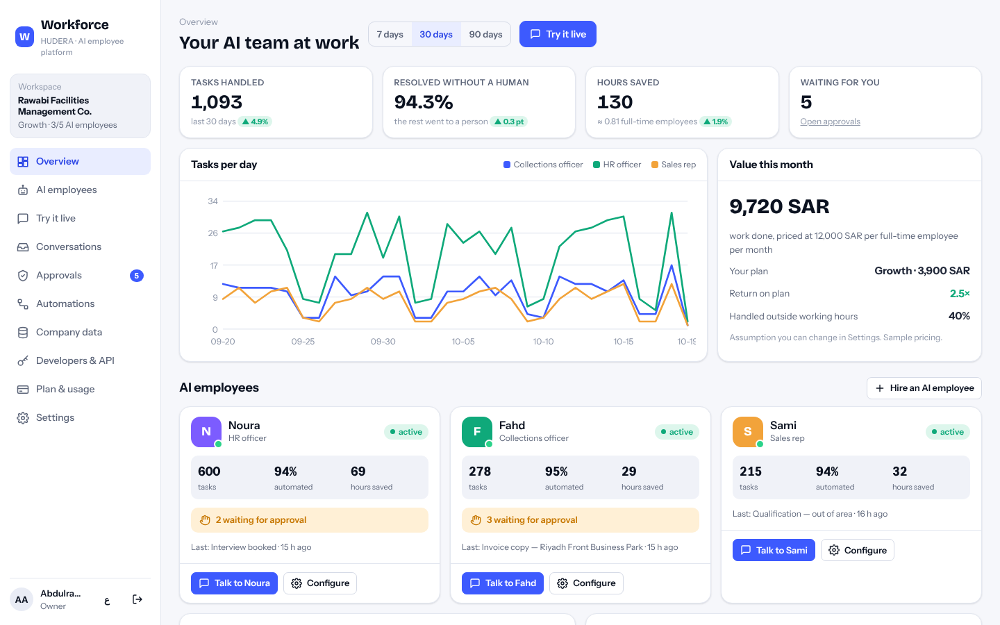
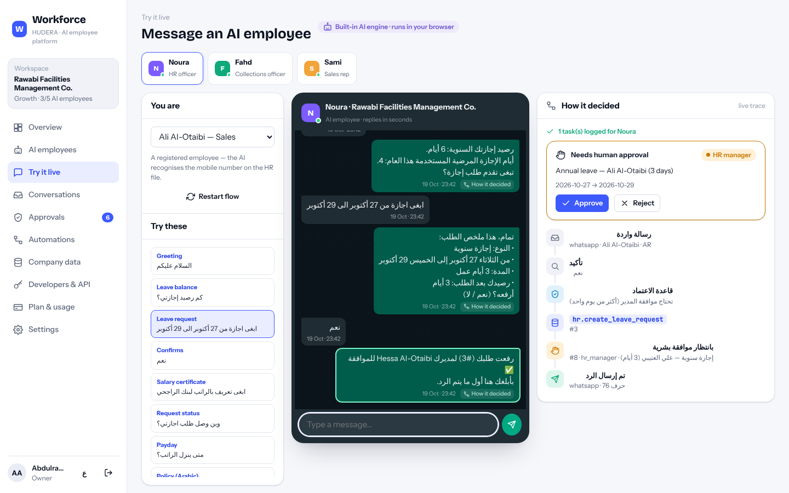
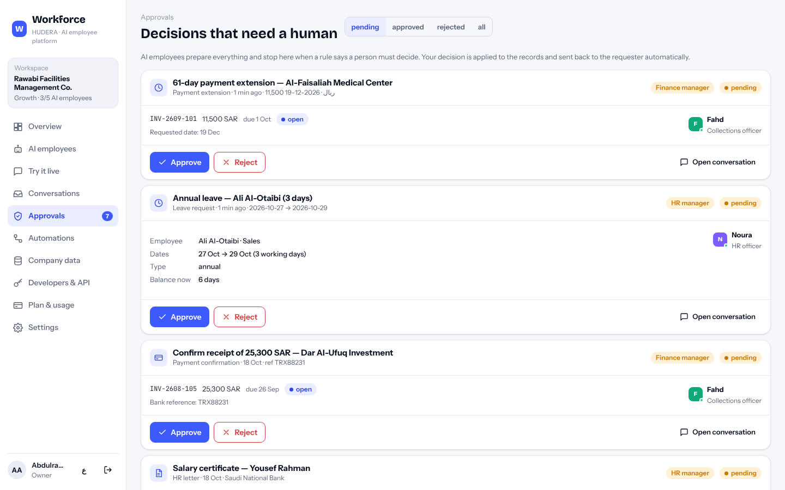
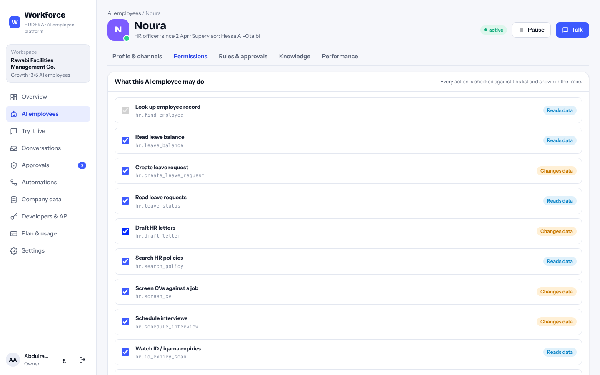
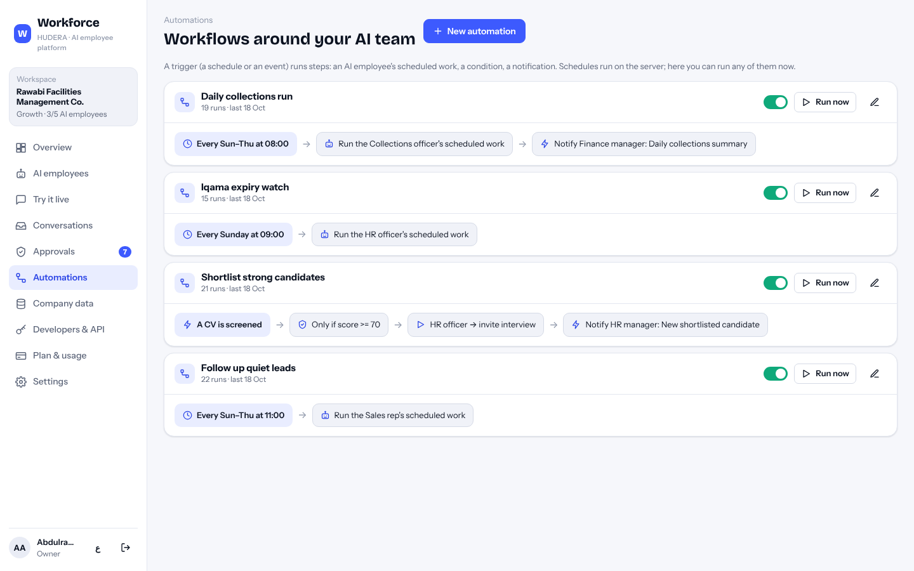
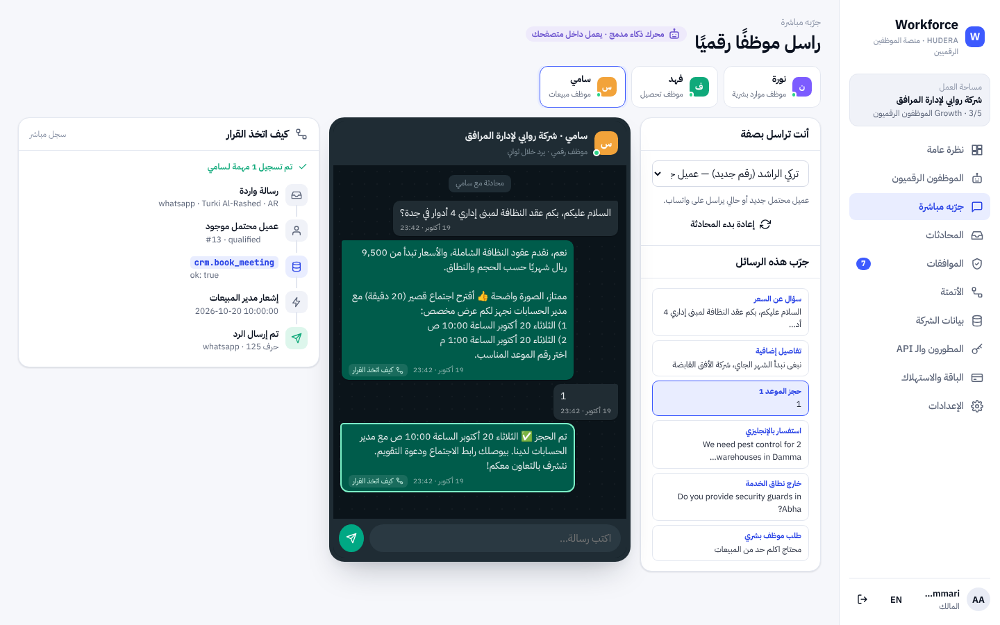
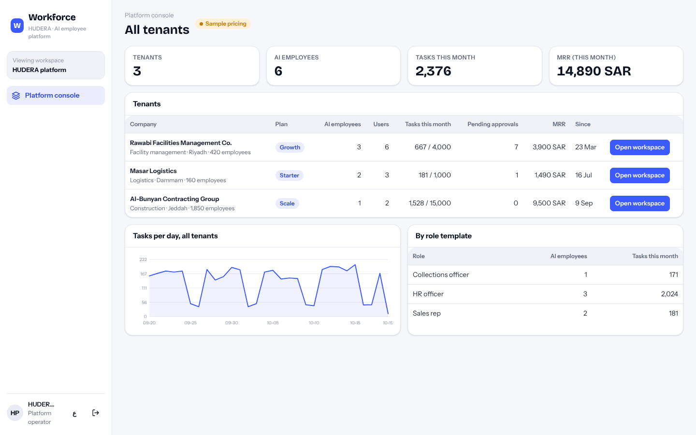
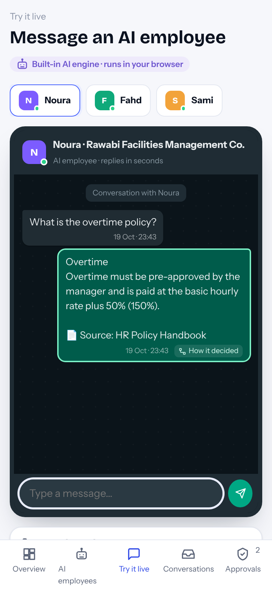

# HUDERA Workforce — AI Employee Platform

**Hire AI employees for HR, collections and sales.** They answer on WhatsApp in Arabic and English, work on your company's own data, follow the rules you set, and stop to ask a human before anything sensitive. Every decision is traced step by step.

**Live demo:** https://hudera-ai.github.io/workforce/ — runs entirely in your browser on sample data (pick any demo user, password `demo1234`).

> Demo data only. The tenant companies (Rawabi Facilities Management, Masar Logistics, Al-Bunyan Contracting), people, phone numbers, invoices and prices are fictional. Prices shown are illustrative.



---

## What it does

| | |
|---|---|
| **AI employees, not chatbots** | Each one has a role (HR officer, collections officer, sales rep), its own permissions, rules, knowledge documents and a human supervisor. Hire one in a minute from a role template. |
| **Real work on real records** | Leave requests, salary certificates, iqama-expiry alerts, CV screening and interview booking · statements, promises to pay, payment claims, disputes and reminder cadences · lead qualification, service matching and meeting booking. |
| **Human in the loop** | Rules decide what is automatic (e.g. a one-day leave with notice) and what needs a person (longer leave, letters, payment confirmations, extensions beyond 14 days, formal notices). The decision is applied to the records and sent back to the requester automatically. |
| **Explainable** | Every reply carries a trace: who was identified, what was understood, which tool read or wrote which data, which rule applied, whether a human must approve. |
| **Permissioned** | Tools are checked against each agent's permission list. Turn one off and the request goes to a human instead. Personal data is only given to the mobile number on the employee file. |
| **Automations** | Schedules (daily collections run, weekly iqama watch, lead follow-ups) and events (`approval.requested`, `approval.decided`, `conversation.handoff`, `candidate.screened`, `lead.scored`) with condition and notify steps. |
| **Multi-tenant PaaS** | Tenants, plans with included tasks and per-task overage, usage metering, API keys, a public REST API, a WhatsApp Cloud API webhook and a platform console for the operator (MRR, usage, tenants). |
| **Bilingual** | Arabic (RTL) and English UI; the agents detect the writer's language and reply in it. |

### Try it live



Message an AI employee as a registered employee, a customer, a job seeker or a new lead, and watch the decision trace build up. Approve or reject from the same screen and see the notification go back to the requester.

| Approvals | Permissions | Automations |
|---|---|---|
|  |  |  |

| Arabic | Platform console | Mobile |
|---|---|---|
|  |  |  |

---

## The AI engine — honestly

Structured work runs on a **deterministic built-in engine** (`shared/agent/`), so results are predictable and auditable:

- **Understanding** — bilingual intent classification (Gulf/Egyptian/MSA Arabic and English), dates (“من 12 نوفمبر الى 14”, “بكرة”, “next Sunday”, “بعد شهرين”, “end of month”), Fri/Sat weekend working-day counts, amounts, invoice numbers, bank references, letter types and addressees.
- **Knowledge** — paragraph-level search over the tenant's own policy documents with bilingual synonyms; answers quote the source, and anything below the confidence threshold is handed to a human.
- **CV screening** — must-have / nice-to-have skills with synonyms (Arabic and English) and years of experience → score and breakdown.
- **Tools & rules** — every data access goes through a permission-checked tool registry; every decision through the agent's rules.

**Optional LLM layer (server):** set `ANTHROPIC_API_KEY` (or `OPENAI_API_KEY`) and free-text questions the engine cannot classify are answered by the model **strictly from the tenant's documents**, or handed to a human. Without a key the platform runs fully on the built-in engine. The browser demo never calls an external model.

---

## Run it

```bash
npm install
npm start            # http://localhost:3000  (SQLite file in ./data, sample data on first run)
npm test             # 17 tests: engine, agent flows, tenancy, roles, API keys, automations, billing
npm run seed         # reset to the sample data
```

Environment (all optional):

| Variable | Purpose |
|---|---|
| `PORT` | HTTP port (default 3000) |
| `DATA_DIR` | where `workforce.sqlite` lives |
| `ANTHROPIC_API_KEY` / `OPENAI_API_KEY`, `LLM_MODEL` | enable the LLM fallback described above |
| `WHATSAPP_VERIFY_TOKEN`, `WHATSAPP_TOKEN`, `WHATSAPP_PHONE_ID` | go live on the WhatsApp Business Cloud API (otherwise replies are logged, not sent) |

The same `index.html` also runs without the server (GitHub Pages, `?mode=local`): the service layer runs in the browser against SQLite compiled to WebAssembly and persists to IndexedDB.

## API

```bash
# Send a message to an AI employee from any channel (web chat, app, ERP…)
curl -X POST http://localhost:3000/api/v1/agents/1/messages \
  -H "x-api-key: hw_live_…" -H "content-type: application/json" \
  -d '{"from":"+9665XXXXXXXX","name":"Sara","text":"كم رصيد إجازتي؟","channel":"web_chat"}'
# → { conversation_id, reply, trace:[…], approvals:[…], tasks:[…] }

# Pending approvals for your own tools (Teams, Slack, ERP)
curl http://localhost:3000/api/v1/approvals -H "x-api-key: hw_live_…"

# WhatsApp Cloud API webhook (verify + receive)
GET/POST /webhooks/whatsapp/:agentId
```

API keys are created in **Developers & API**, shown once, and stored hashed (PBKDF2).

## Architecture

```
index.html, src/            Vanilla ES-module UI (no framework, no build step), AR/EN, light/dark
  api.js                    one client, two transports: HTTP RPC ↔ in-browser service
  views/                    dashboard, AI employees, simulator, conversations, approvals,
                            automations, company data, developers, billing, settings, platform
shared/                     runs identically on the server and in the browser
  service.js                every operation (51 ops) with tenant scoping and role checks
  agent/runtime.js          message → understanding → tools → rules → reply / task / approval + trace
  agent/nlu.js, kb.js       Arabic/English understanding, dates, CV scoring, knowledge search
  agent/tools.js            permission-checked tool registry + role templates
  agent/roles/*.js          HR, collections, sales behaviours
  seed.js                   fictional tenants; sample conversations are produced by the runtime itself
server/src/                 Express 5: /api/rpc/:op, /api/v1 public API, WhatsApp webhook, scheduler, LLM adapter
db/schema.sql               SQLite schema (tenants, plans, agents, tools, rules, knowledge, conversations,
                            messages with traces, tasks, approvals, automations, audit log, company data)
```

## Roles in a workspace

`owner` (everything) · `hr_manager` / `finance_manager` / `sales_manager` (configure their AI employee, decide its approvals) · `viewer` (read-only) · `platform` (HUDERA operator: all tenants, can open any workspace).

---

### بالعربي

**HUDERA Workforce** منصة لتوظيف «موظفين رقميين» للموارد البشرية والتحصيل والمبيعات. يردون على واتساب بالعربي والإنجليزي، يشتغلون على بيانات الشركة نفسها، يلتزمون بالقواعد التي تحددها، ويرجعون لموظف بشري قبل أي قرار حساس — وكل قرار له سجل خطوات واضح. المنصة متعددة الشركات (SaaS/PaaS) بباقات واستهلاك ومفاتيح API وWebhook لواتساب ولوحة لمشغّل المنصة. البيانات في العرض افتراضية بالكامل.

---

Built by **HUDERA AI** · MIT licence
